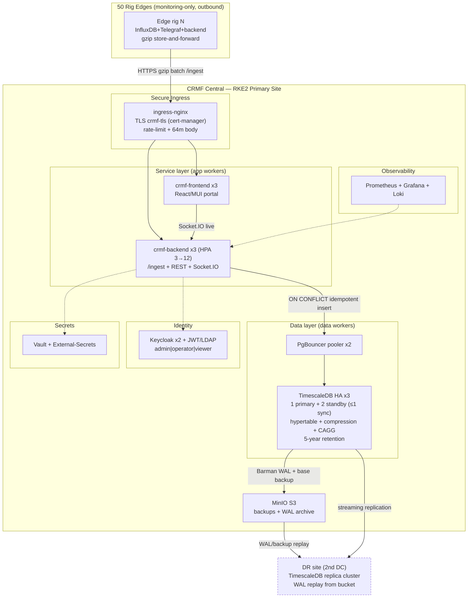

# AHWR Digital Twin — Full-Implementation Hardware, Central Architecture & Installation Guide

**Document class:** Production-grade technical specification
**Baseline sources:** AHWR-Digital-Twin-Production-Rollout deck (slides 7 / 9 / 17) reconciled against the extracted repository facts (edge Docker Compose stack, `central/` CRMF project — Helm chart, CloudNativePG TimescaleDB manifests, RKE2/Ansible platform, backend/lib sources).
**Governing invariant:** The AHWR twin is **monitoring-only**. Data flows **outbound only**, rig → central. No component of the edge or central stack ever writes to a PLC or rig control path. ESD / lockout appear as **read-only alarm events**, never as commands.

> **Reconciliation convention used throughout.** Where the repository ships a **STARTER** value (a placeholder or laptop/pilot-sized number in a manifest) that must be scaled for production, both numbers are shown and labelled — `STARTER` (what the repo ships today) vs `PRODUCTION` (the deck target the operator must set). The most consequential example: TimescaleDB per-instance storage is `50Gi` data + `20Gi` WAL in the manifest (STARTER) vs the deck's `5 TB` data + `500 GB` WAL per instance (PRODUCTION) — a ~100× gap the operator must close via a values override. **Note (see §3.1.3):** the deck's 5 TB/instance target is itself insufficient for the stated 5-year retention horizon and must be raised to ~15–20 TB/instance to actually hold 5 years of compressed raw.

---

## 1. Scope & workload envelope

### 1.1 Fleet definition

| Parameter | Value | Source |
|---|---|---|
| Fleet size | 50 rigs | Deck slide 7; repo `FLEET_SIZE=50` (central `.env.example`, backend default, `values-local.yaml`) |
| Tags per rig | **< 500** @ 1 Hz | Deck slide 7; repo basis = Telegraf `interval="1s"` / `flush_interval="1s"` + managed `s7comm` tag list (~10 equipment groups) |
| Collection cadence | 1 Hz collect **and** flush | `telegraf/telegraf.conf:9-19` |
| PLC transport (edge) | Siemens S7 (`inputs.s7comm`, `192.168.0.11:102`) | `telegraf.conf:40-41` (the `[[inputs.s7comm]]` block) |

### 1.2 Ingest envelope (fleet arithmetic)

| Quantity | Formula | Result | Deck ceiling |
|---|---|---|---|
| Values / second | 50 × 500 × 1 Hz | **25,000 /s** | `< 25,000/s` ✓ |
| Values / day | 25,000 × 86,400 | **2.16 billion/day** | `< 2.16B/day` ✓ |
| Values / year | 2.16e9 × 365 | 788.4 billion/yr | — |
| Values / 5-year window | 788.4e9 × 5 | 3.942 trillion | — |

Because tags are strictly **< 500**, live throughput is strictly **below** these ceilings — the deck's `<` is exact. These figures set every downstream sizing decision (edge SSD, central TimescaleDB storage, WAN bandwidth).

### 1.3 Retention — two distinct horizons (do not conflate)

| Tier | Horizon | Mechanism | Source |
|---|---|---|---|
| **Edge historian (per rig)** | **90 days raw** | InfluxDB v2 bucket, `DOCKER_INFLUXDB_INIT_RETENTION=${INFLUX_RETENTION:-90d}` | `docker-compose.yml:23-26`, `.env.example:13` |
| **Central telemetry** | **5 years raw** | TimescaleDB `add_retention_policy('telemetry', INTERVAL '5 years')` | `central/db/init.sql` L109 |
| Edge store-and-forward buffer | 15 days (**not** a retention horizon — a WAN-outage disk queue cap) | `SYNC_BUFFER_DAYS=15` | `backend/lib/sync.js` L29 |

> **Caveat.** The edge `90d` retention only applies at **first init of a new InfluxDB volume**. On an already-provisioned rig it must be changed in place with `influx bucket update --retention`. The 15-day sync buffer is a separate quantity from the 90-day historian retention — it bounds the un-acked gzip batch queue during a WAN outage, nothing more.

### 1.4 Monitoring-only / read-only boundary (project-wide)

- Edge → central sync is **OUTBOUND ONLY**; the sync agent "never writes to the PLC" (`backend/lib/sync.js:6`).
- Edge MCP server is **read-only**; its opaque service credential is accepted by the backend "only for safe methods" (GET/HEAD/OPTIONS).
- Central `NetworkPolicy` is **default-deny** on both ingress and egress; **no policy permits egress back toward rigs/PLCs** (`01-network-baseline.yaml`, `02-network-allows.yaml`).
- Central ETP/WITSML scaffold is `READ_ONLY:true` (disables `WMLS_AddToStore`/`DeleteFromStore`); MQTT ACL denies all rig subscribe and permits publish only under `rigs/${username}/*`.

---

## 2. Edge hardware requirements (per rig)

Each rig runs an **identical golden image** — a Docker Compose project. Only `DEVICE_ID` and `DEVICE_TOKEN` differ per node (`.env.example:65-82`). Production runs **5 core containers** (`influxdb`, `telegraf`, `backend`, `mcp-edge`, `frontend`) on an internal-only Docker network; the 6 `demo`-profile stubs are excluded in production via `profiles:["demo"]`.

### 2.1 Software footprint — container resource caps

Limits are self-described as tuned to "suit a 4c/16GB rig PC" (`docker-compose.yml:11-13`). InfluxDB is called out as "the heaviest edge consumer (TSM cache)."

| Service | Image / build | cpus | mem_limit | mem_reservation | Host port | Core/Demo |
|---|---|---|---|---|---|---|
| influxdb | `influxdb:2.7` | 2.0 | 2 GB | 512 MB | none (UI `127.0.0.1:8086` commented) | Core |
| telegraf | `telegraf:1.29` | 0.5 | 512 MB | 128 MB | none (health `:8888` internal) | Core |
| backend | `backend/Dockerfile` | 1.5 | 1 GB | 256 MB | none (behind nginx) | Core |
| mcp-edge | `edge-mcp-server` | 0.25 | 192 MB | 48 MB | `127.0.0.1:8765→3000` (TLS) | Core |
| frontend | `frontend/Dockerfile` | 0.5 | 256 MB | 64 MB | `127.0.0.1:8080→80` | Core |
| **Core total** | | **4.75 vCPU** | **3.96 GB** | **0.98 GB** | | |
| mock, opc-plc, telegraf-opcua, openldap, sync-sink, etp-sink | — | — | — | — | none | **Demo (excluded in prod)** |

> The container **limits** (4.75 vCPU / 3.96 GB) are the ceiling under contention; **reservations** (0.98 GB) are only soft guarantees. Host sizing must budget the **limit ceiling plus OS + Docker Engine overhead**, not the reservations.

### 2.2 Network posture (loopback-first, monitoring-only)

- Only the **frontend HMI** (`127.0.0.1:8080`) and the **read-only mcp-edge HTTPS** endpoint (`127.0.0.1:8765`) publish host ports; both bind loopback by default.
- InfluxDB, Telegraf and the backend have **no host ports** — internal Docker network only.
- To expose the HMI on the rig LAN, set `FRONTEND_BIND` to the rig NIC IP behind the firewall — "don't drop the `127.0.0.1` prefix to bind `0.0.0.0` blindly" (`docker-compose.yml:190-194`).
- Edge TLS is terminated only at mcp-edge (self-signed cert from `./certs`; swap in a CA-signed cert for production). The HMI is plain HTTP on loopback, protected by the loopback bind + rig firewall.

### 2.3 Per-rig 90-day storage math

| Item | Assumption | Formula | Result |
|---|---|---|---|
| Points/rig/90d | 500 tags @ 1 Hz | 500 × 86,400 × 90 | 3.888 billion |
| Uncompressed (min) | 16 B/pt (8B ts + 8B float64) | 3.888e9 × 16 | 62.2 GB |
| Uncompressed (w/ overhead) | 32 B/pt | 3.888e9 × 32 | 124.4 GB |
| **Compressed (InfluxDB TSM)** | 2.5–3 B/pt (~5.3–6.4× vs 16 B/pt) | 3.888e9 × 2.5–3 | **9.7–11.7 GB** |
| Plus store-and-forward buffer | up to 15 days gzip'd batches during WAN outage | — | headroom on `backend_data` volume |

> **Compression-ratio note.** Relative to the 16 B/pt minimum uncompressed size, 2.5–3 B/pt is ~5.3–6.4× (16 / 3 = 5.3×, 16 / 2.5 = 6.4×). The earlier "~6–8×" was unsupported: an 8× ratio would require 2 B/pt, outside the stated 2.5–3 B/pt range.

Even **uncompressed** (~125 GB) the 90-day historian consumes ~12% of a 1 TB SSD; compressed it is ~1%. The **1 TB high-endurance SSD is driven by write-endurance and buffer headroom, not capacity** — InfluxDB's continuous TSM writes at 1 Hz plus up to 15 days of disk-buffered sync batches make sustained-write endurance the binding constraint.

### 2.4 Network / WAN needs (outbound gzip sync)

| Scope | Uncompressed | gzip (~6×) |
|---|---|---|
| Per rig | ~15 KB/s (~120 kbit/s) | **~2.5 KB/s (~20 kbit/s)** |
| Per rig / day | ~1.3 GB/day | ~216 MB/day |
| Fleet (50) | ~750 KB/s (~6 Mbit/s) | **~125 KB/s (~1 Mbit/s)** |
| Fleet / day | ~65 GB/day | ~10.8 GB/day |

> **Unit convention.** These figures use decimal MB/GB consistently with the uncompressed rows (750 KB/s × 86,400 = 64.8 GB ≈ 65 GB/day). Per-rig gzip = 2.5 KB/s × 86,400 = 216,000 KB ≈ 216 MB/day; fleet gzip = 65 GB ÷ 6 ≈ 10.8 GB/day. (An earlier draft mixed decimal KB with binary MB/GB, yielding ~211 MB / ~10.5 GB.)

Sync mechanics: batches sealed every `SYNC_BATCH_SECONDS=10`, gzip-compressed, POSTed to `<CENTRAL_URL>/ingest` (5 s timeout, `Content-Encoding: gzip`, `X-Device-Id`, `X-Schema-Version`, optional `Authorization: Bearer <DEVICE_TOKEN>`). During a WAN outage batches disk-buffer to `DATA_DIR/sync_buffer` for up to `SYNC_BUFFER_DAYS=15`, replayed **oldest-first** on reconnect. The rig HMI keeps working locally regardless of central availability.

### 2.5 Edge sizing table — minimum vs recommended

Deck slide 9 baseline reconciled with the compose "4c/16GB rig PC" intent. Compose limits fit a 4c/16GB box; production headroom argues for the upper end.

| Component | Minimum (compose "4c/16GB" basis) | Recommended (production) | Rationale |
|---|---|---|---|
| CPU | 4 cores | 8 cores | Core containers cap at 4.75 vCPU; leave headroom for OS/Docker + burst |
| RAM | 16 GB | 32 GB | Core limits sum to 3.96 GB; InfluxDB TSM cache + OS/Docker want slack |
| System disk / historian | 1 TB high-endurance SSD | 1 TB high-endurance (DWPD-rated) SSD | 90-day raw ≤ ~125 GB uncompressed; endurance + 15-day buffer drive the spec, not capacity |
| HMI | 24" operator display | 24" industrial HMI panel | Frontend is the only operator-facing service |
| Network switch | Managed switch | Managed switch (VLAN-capable) | Segregate PLC subnet (`192.168.0.x`) from WAN |
| Security appliance | Firewall / VPN | Firewall + site-to-site VPN | Outbound-only sync to CRMF ingress; loopback-bound HMI |
| Power | UPS ≥ 30 min runtime | UPS ≥ 30 min runtime | Graceful shutdown / ride-through |
| Redundancy | — | **Cold-standby edge PC per rollout group** | Rapid swap; identical golden image makes recovery a DEVICE_ID/TOKEN restore |

**Per-rig bill of materials (one line):** 1× industrial edge PC (4–8 core / 16–32 GB / 1 TB high-endurance SSD) + 1× 24" HMI + 1× managed switch + 1× firewall/VPN appliance + 1× UPS (≥30 min) — plus **one cold-standby edge PC shared per rollout group**.

---

## 3. Central hardware requirements

Two clearly separated deployment classes. **3a — Production HA (RKE2)** is the full 50-rig target from the deck. **3b — Single-node / pilot** is the repo's documented small-footprint path for ~5–10 rigs.

### 3.1 (3a) Production HA — RKE2 cluster

The deck (slide 17) specifies a **9-worker-node compute plane** (3 control-plane + 3 general worker + 3 data worker). The repository ships an **example inventory** (`inventory.example.ini`) that is a smaller STARTER topology (3 control-plane + 4 workers = 2 app + 2 data). Both are shown; the deck figures are the production target the operator provisions.

#### 3.1.1 Node table — deck production target (slide 17)

| Node role | Count | vCPU | RAM | System disk | NIC | Notes |
|---|---|---|---|---|---|---|
| Control-plane (RKE2 server) | 3 | 8 | 32 GB | 200 GB SSD | dual 10 GbE | HA API/etcd; first = `server-bootstrap` (API 6443, join 9345), VIP `crmf-cp.ongc.local` / `10.20.0.10` |
| General worker (app tier) | 3 | 16 | 64 GB | 500 GB SSD | dual 10 GbE | Backend/frontend/ingress/observability; label `role=app` |
| Data worker (data tier) | 3 | 24 | 128 GB | 1 TB NVMe + CSI block | dual 10 GbE | TimescaleDB/Kafka/MinIO; label `role=data` |

> **STARTER vs PRODUCTION topology.** Repo `inventory.example.ini` (STARTER) = 3 control-plane + 2 app workers + 2 data workers = **7 nodes**, with a warm-standby **DR** site of 3 servers + 2 agents = 5 nodes (12 total). Deck (PRODUCTION) = 3 + 3 + 3 = **9 worker-bearing nodes** at the fixed vCPU/RAM/disk envelopes above. Worker "app" vs "data" separation is by **node label only** (`crmf.ongc.local/role=app|data`) — there is no separate RKE2 data-plane role; pin data services with `nodeSelector`/affinity in production.

#### 3.1.2 Compute rollup (deck target, excluding DB storage)

| Tier | Nodes | vCPU total | RAM total | Fast disk total |
|---|---|---|---|---|
| Control-plane | 3 | 24 | 96 GB | 600 GB SSD |
| General worker | 3 | 48 | 192 GB | 1.5 TB SSD |
| Data worker | 3 | 72 | 384 GB | 3 TB NVMe (+ CSI block below) |
| **Cluster total** | **9** | **144 vCPU** | **672 GB RAM** | **~5.1 TB node-local fast disk** |

#### 3.1.3 TimescaleDB storage — STARTER vs PRODUCTION (critical)

TimescaleDB is a CloudNativePG-managed HA cluster (`crmf-timescaledb`): **3 instances = 1 primary + 2 streaming replicas** (each a full physical copy of the same data), ≤1 synchronous standby (non-blocking).

| Attribute | Manifest **STARTER** (`00-cluster.yaml`) | Deck **PRODUCTION** target (slide 17) |
|---|---|---|
| Data / instance | `storage.size: 50Gi` | **5 TB** (deck) — **insufficient for 5-yr retention; see below** |
| WAL / instance | `walStorage.size: 20Gi` | **500 GB** |
| Instances | 3 | 3 |
| **Total provisioned disk (all 3 replicas)** | 3 × (50Gi + 20Gi) ≈ **210 GiB** | 3 × (5 TB + 500 GB) ≈ **16.5 TB** — *provisioned disk = 3× one 5 TB copy, NOT a data-retention budget* |
| storageClass | commented (cluster default) | must set real CSI block class (e.g. `ongc-block`) |
| Per-pod CPU req/lim | 1 / 4 | (data-worker envelope: up to 24 vCPU host) |
| Per-pod RAM req/lim | 4Gi / 8Gi | (data-worker envelope: up to 128 GB host) |

**Storage reconciliation — the 16.5 TB figure is provisioned disk, not a retention budget (corrected).** The 3 TimescaleDB instances form a CloudNativePG HA cluster = **1 primary + 2 streaming replicas**, each holding a *full physical copy* of the identical data (as stated here and in §4.1). Distinct-data capacity is therefore **ONE instance's volume = 5 TB data (+ 0.5 TB WAL)**, not the 16.5 TB sum. The ~16.5 TB (3 × (5 TB + 500 GB)) is **total provisioned disk across the three replicas** and is unrelated to how much history the cluster can retain.

**How much history actually fits in 5 TB/instance?** Raw uncompressed heap ≈ 788.4e9 pts/yr × ~75 B ≈ **59.1 TB/yr**. TimescaleDB columnar compression (segmentby `rig_id, metric`) at 15–20× → 2.96–3.94 TB/yr → **14.8–19.7 TB over 5 years**. This 5-year compressed raw must live on **each** instance's 5 TB volume and does **not** fit — it is **3–4× oversize**. Equivalently, a 5 TB instance at the mid-band 18× holds only 5 TB × 18 = **90 TB uncompressed ≈ ~1.5 years** of raw (at 59.1 TB/yr), **not 5 years**. To actually retain 5 years in 5 TB you would need ~59× compression — far above the cited 15–20×.

**Consequence (the earlier "16.5 TB is coherent under 5-year retention" conclusion is withdrawn).** The deck's 5 TB/instance target supports only ~1.5 years of raw at 18×. To retain the deck's 5-year horizon (`init.sql` `add_retention_policy('telemetry', INTERVAL '5 years')`), `storage.size` must be **~15–20 TB/instance** (→ **~45–60 TB provisioned** across the 3 replicas), OR retention must be cut to **~18 months at 5 TB/instance**. The 16.5 TB number should be read as total provisioned disk (= 3× a single 5 TB copy), which is not a data-retention budget.

**1-minute continuous aggregate headroom.** The `telemetry_1m` CAGG adds ~5.9 TB/5yr uncompressed and has **no retention policy**, so it too must fit on **each** instance's volume alongside compressed raw. Even if one (incorrectly) treated 16.5 TB as a usable single-copy data budget, fitting would require **both** the ~20× raw end (14.8 TB) **and** CAGG compression to ≤~1.7 TB — the ~20× raw end *alone* leaves 14.8 + 5.9 = **20.7 TB**, still ~4.2 TB over 16.5 TB, so CAGG compression is mandatory, not an alternative. Against the *real* 5 TB per-instance budget, neither raw nor CAGG fits at 5-year retention without the storage resize above.

#### 3.1.4 Object/backup + DR (deck)

| Component | Spec | Source |
|---|---|---|
| Object / backup store | **20 TB usable** (≈1.2× the deck's 16.5 TB provisioned-disk figure) — CNPG base backups + WAL archive, retained generations. *Note: if per-instance data is resized to ~15–20 TB for true 5-yr retention (§3.1.3), the backup store must be re-sized proportionally.* | Deck slide 17; repo MinIO `s3://crmf-backups`, 30-day CNPG retention / 90-day ILM |
| DR site | Independent cluster at 2nd data centre, sized to **approved RPO/RTO** | Deck; repo `crmf-timescaledb-dr` = 2-instance replica cluster (STARTER 50Gi/20Gi) |
| Restore verification | Weekly throwaway restore-test cluster, RPO check ≤ 7200 s (2 h) | `05-restore-test.yaml` |

> **DR storage must be scaled identically** — the DR replica manifest also ships STARTER `50Gi/20Gi` per instance and points `endpointURL` at the in-cluster `http://minio:9000`; production must repoint it at the DR data-centre MinIO and size it to the same per-instance data/WAL envelope as the primary (the deck's 5 TB/500 GB, subject to the §3.1.3 correction for real 5-year retention).

### 3.2 (3b) Single-node / pilot — ~5–10 rigs

The repo ships two documented small-footprint paths that use the **identical images and identical `/ingest` + Socket.IO contract** as production — only the surrounding plane changes.

**(i) Docker Compose pilot** (`central/docker-compose.yml`) — README: "this compose runs a single node for the pilot." Four always-on services: `timescaledb` (single node) + `crmf-backend` (`/ingest` + REST + Socket.IO, `:6000`) + `crmf-mcp` (read-only HTTPS `/mcp`, the only service with declared limits: 0.25 cpu / 192m) + `crmf-frontend` (`:8090`). Optional `demo` profile adds `fleet-sim`, `openldap`, `notify-sink`.

**(ii) kind single-node K8s** (`central/deploy/local/`) — reproduces production mechanics (CNPG TimescaleDB, Helm chart w/ HPA/PDB/NetworkPolicy/Ingress+TLS, cert-manager, metrics-server) sized to ~4–5 GiB Docker memory. Omits Kafka/Keycloak/EMQX/MinIO/MLflow (the full platform ≈ 25 GiB of pod requests won't schedule on a laptop).

| Resource | Compose pilot (~5–10 rigs) | kind local | Notes |
|---|---|---|---|
| CPU | ~2–4 vCPU | 2–4 vCPU | Only `crmf-mcp` caps CPU (0.25) in compose; DB + backend are the movers |
| RAM | ~4–6 GiB | ~4–5 GiB (Docker) | Full platform ~25 GiB won't fit; trimmed stack targets ~4–5 GiB |
| Disk | ~20–50 GiB SSD | 2Gi DB PVC + images | Compression + 1-min CAGG keep growth modest at 5–10 rigs; size for retention |
| DB instances | 1 (single node) | 1 CNPG instance | vs prod 3 (1 primary + 2 standby) |
| DB storage | `crmf_pgdata` volume (unbounded) | **2Gi** (STARTER) | vs prod 50Gi→5 TB |
| Backup / DR | none | none | vs prod Barman→MinIO + DR replica |
| Autoscale/HA | none | HPA 1→3, PDB minAvailable 1 | vs prod HPA 3→12, PDB minAvailable 2 |

> Compose defines explicit limits **only** on `crmf-mcp`; the pilot CPU/RAM figures above are inferred from the workload, not declared in the file. Load = rigs × 1 Hz × ~100 channels in 10 s gzip batches. Map "~5–10 rigs" to `ACTIVE_RIGS` in that range (compose) or the kind sim's 6; `FLEET_SIZE=50` only seeds the registry/governance funnel.

---

## 4. Central server architecture (CRMF — Centralised Rig Monitoring Facility)

### 4.1 Layered description

1. **Secure ingress / TLS + rate-limit.** `ingress-nginx` (class `nginx`, host `crmf.ongc.local`, TLS `crmf-tls` via cert-manager). Path routing: `/ingest`, `/api`, `/socket.io` → `crmf-backend:6000`; `/` catch-all → `crmf-frontend:80`. `/ingest` precedes the catch-all. Ingest tuning: `proxy-body-size 64m` (large gzip batches), `proxy-read/send-timeout 3600` (long-lived websockets), `proxy-http-version 1.1`. `/metrics` is **never** exposed via Ingress (internal ServiceMonitor scrape only). App-layer `express-rate-limit`: `/ingest` 6000/min, api 600/min, login 10/min; `/ingest` raw body limit 64 MB.
2. **Service layer (Node/Express + Socket.IO, monitoring-only).** Backend `crmf-backend` (ClusterIP `:6000`), **3 replicas governed by HPA** (min 3, max 12, CPU target 70%), PDB minAvailable 2. Frontend `crmf-frontend` (ClusterIP `:80`), **fixed 3 replicas** (no HPA), PDB minAvailable 2. Restrictive pods: `readOnlyRootFilesystem`, `runAsNonRoot`, drop ALL caps, seccomp `RuntimeDefault`, uid/gid 10001, `automountServiceAccountToken:false`. Probes split DB-aware readiness (`/healthz`, `SELECT 1`) from DB-free liveness (`/livez`) so a DB blip drains traffic without a restart storm.
3. **Data layer (TimescaleDB HA).** CloudNativePG-managed PostgreSQL 16 + TimescaleDB + PostGIS. 3 instances (1 primary + 2 streaming replicas, ≤1 synchronous, non-blocking; each replica a full physical copy). Long/narrow `telemetry(ts, rig_id, metric, value)` hypertable (1-day chunks); native compression after 7 days (segmentby `rig_id, metric`); 1-minute real-time continuous aggregate `telemetry_1m`; 5-year retention. Optional 2-replica PgBouncer pooler (transaction mode).
4. **Portal (React/MUI).** Vite + MUI + Recharts behind nginx, consuming REST + Socket.IO live streams.
5. **Identity.** Local bcrypt + HS256 JWT (roles `admin|operator|viewer`, TTL 12h, fail-fast on placeholder `JWT_SECRET`); LDAP/AD bind with group→role mapping; OIDC/Keycloak (default off) federated with ONGC AD over LDAPS. **MFA is not configured in the shipped realm import** — see §5e.
6. **Platform.** RKE2 v1.30.4+rke2r1, Cilium CNI (replaces canal for NetworkPolicy + observability), bundled RKE2 ingress disabled. Operators (dependency order): cert-manager, ingress-nginx, external-secrets (off by default), CloudNativePG, Strimzi (opt), Keycloak (opt), kube-prometheus-stack, MinIO operator (opt). Secrets via HashiCorp Vault + External-Secrets; MinIO = S3 backup/WAL + MLflow artifact store.
7. **Optional / Phase-2.** Kafka (Strimzi, 3-broker KRaft) is production-ready but off by default; **MLflow and ETP/WITSML are honest Phase-2 scaffolds pinned to `replicas:0`** and will not run as-shipped. MQTT (EMQX, mutual-TLS device identity) ships single-replica with the TLS cert commented out.

### 4.2 Per-component replicas & resources (prod)

| Component | Replicas (prod) | CPU req/lim | Mem req/lim | Port | Notes |
|---|---|---|---|---|---|
| backend | 3 (HPA 3→12 @70%) | 500m / 2 | 512Mi / 1Gi | 6000 | ClusterIP; PDB minAvailable 2 |
| frontend | 3 (fixed) | 100m / 500m | 128Mi / 256Mi | 80 | No HPA; PDB minAvailable 2 |
| TimescaleDB (per instance ×3) | 3 | 1 / 4 | 4Gi / 8Gi | 5432 | max_connections 300, shared_buffers 2GB, effective_cache_size 6GB |
| PgBouncer pooler | 2 | 100m / 1 | 128Mi / 256Mi | 5432 | transaction mode; max_client_conn 1000, pool 50 |
| DR TimescaleDB (per inst ×2) | 2 | 1 / 2 | 4Gi / 8Gi | 5432 | replica cluster, 2nd DC |
| Kafka brokers (opt) | 3 | — | — | 9092/9093 | KRaft dual-role, 100Gi JBOD each, RF 3, min ISR 2 |
| Keycloak (opt) | 2 | — | — | — | HA, dedicated CNPG DB, Infinispan k8s cache |
| EMQX MQTT (opt) | 1 (scale to 3) | — | — | 8883 mTLS | per-rig client-cert CN = rigId |
| MinIO | 1 (Operator Tenant for HA) | — | — | 9000/9001 | buckets: reports, backups, mlflow |
| MLflow / ETP-WITSML | **0 (Phase-2 scaffold)** | — | — | — | not on production path |

### 4.3 Architecture diagram



### 4.4 Ingest data flow

1. Edge seals a gzip batch every 10 s → `POST <CENTRAL_URL>/ingest` (`Content-Encoding: gzip`, `X-Device-Id`, `X-Schema-Version: 1.0`, `Bearer DEVICE_TOKEN`).
2. ingress-nginx (TLS-terminated, `proxy-body-size 64m`) → `crmf-backend:6000`.
3. Backend bulk-inserts telemetry via a single `UNNEST`'d statement with **`ON CONFLICT (rig_id, metric, ts) DO NOTHING`** (idempotent store-and-forward replay dedup), all in one `BEGIN/COMMIT` per batch on a pooled client. A replay fast-path rejects batches whose `seq <= rig.last_seq`. `events`/`connections` insert `ON CONFLICT DO NOTHING`; `rig_latest` upserts a JSONB last-value cache.
4. Rows land in the `telemetry` hypertable (1-day chunks). After 7 days chunks compress columnar (segmentby `rig_id, metric`). The `telemetry_1m` real-time CAGG serves long-range rollups; the 5-year retention policy drops aged raw chunks.
5. The React/MUI portal reads REST + Socket.IO live streams; ingest never traverses back toward any rig.

### 4.5 HA / DR story

| Control | Setting | Source |
|---|---|---|
| Sync replication | `minSyncReplicas 0` / `maxSyncReplicas 1` — keeps ≤1 sync standby, **never blocks writes** if both standbys fail (availability over durability in that degraded window) | `00-cluster.yaml` |
| Primary update | `unsupervised`, `switchover` | `00-cluster.yaml` |
| WAL archiving | Barman Cloud, gzip, continuous, `maxParallel 4` | `00-cluster.yaml` |
| Base backup | Daily 02:30 (`0 30 2 * * *`), immediate | `02-backup.yaml` |
| Backup retention | 30 days (Barman); MinIO ILM 90 days | `00-cluster.yaml`, MinIO |
| DR | Separate 2-instance replica cluster at 2nd DC; recovers from bucket + replays streamed WAL; promote by `replica.enabled:false` | `03-dr-replica-cluster.yaml` |
| Restore test | Weekly Sun 03:30 throwaway cluster; verifies extension + hypertables + rows + latest ts within **RPO 7200 s (2 h)**; pushes success gauge to Prometheus | `05-restore-test.yaml` |
| Alerting | PrometheusRule: backend down, ingest error >5%, no-ingest, fleet offline >25%, cert-expiry <14d, DB PVC >85%, WAL-archive stalled, restore-test stale, replication lag >30s | `observability/*` |

> **Backup-engine note.** Some headings say "pgBackRest," but the deployed mechanism is **CloudNativePG's Barman Cloud** (`barmanObjectStore`) to MinIO. Cold-archival of aged-out chunks to object storage (tiered storage / chunk-export-to-S3) is referenced in `init.sql` but **not implemented in these manifests** — it is decoupled from the 30-day backup retention and must be wired separately if required.

---

## 5. Installation guidelines

### 5a. Prerequisites

- **Control workstation:** `ansible`, `kubectl`, `helm`, `git`, SSH access to all nodes.
- **Pilot / kind host:** `docker`, and (for kind) `kind` + `kubectl` + `helm`.
- **Registry:** Harbor at `harbor.ongc.local` holding `crmf/crmf-backend:1.0.0`, `crmf/crmf-frontend:1.0.0` (+ `fleet-sim` for demo), pull secret `harbor-pull-secret`.
- **DNS/PKI:** `crmf.ongc.local` resolvable; a real cert-manager ClusterIssuer name to replace the placeholder `letsencrypt-or-ongc-ca`; ONGC internal CA available for air-gapped sites.
- **Secrets backend:** HashiCorp Vault (`https://vault.ongc.local:8200`, KV v2 mount `crmf`) reachable, for the production External-Secrets path.
- **Network:** rig-edge sites can reach the ingress over HTTPS; central egress restricted to DB + DNS (monitoring-only default-deny).

### 5b. HA production install (RKE2)

Ansible drives three phases (`site.yml` → `10-rke2-bootstrap` → `20-operators` → `30-crmf-deploy`).

```bash
# 0. Prepare inventory & group_vars from the examples, set the deck node topology
cd repo/central/deploy/ansible
cp inventory.example.ini inventory.ini          # 3 control-plane + 3 app + 3 data workers (deck)
cp group_vars/all.example.yml group_vars/all.yml # pin RKE2 v1.30.4+rke2r1, CNI cilium, VIP, tls-san

# 1. Full run (bootstrap RKE2 -> operators -> CRMF)
ansible-playbook -i inventory.ini site.yml
```

Node roles: the first server is `rke2_node_role=server-bootstrap` (API `6443`, join `9345`); additional control-plane are `server`; workers are agents specialised by label `crmf.ongc.local/role=app|data`.

Operators install in dependency order (versions pinned in `all.yml`): cert-manager v1.15.3 → ingress-nginx 4.11.2 → external-secrets 0.10.4 (enable for prod) → CloudNativePG 0.22.0 → [Strimzi 0.43.0] → [Keycloak 25.0.4] → kube-prometheus-stack 62.6.0 → [MinIO operator 5.0.15]. Bracketed operators are optional (`kafka_enabled` / `oidc_enabled` / `minio_enabled`).

**TimescaleDB cluster — MUST override STARTER storage for production:**

```bash
# Apply the platform TimescaleDB manifests, but scale storage from STARTER 50Gi/20Gi
# to the deck target and set a real CSI block class.
kubectl apply -f repo/central/deploy/k8s/platform/timescaledb/01-schema-configmap.yaml
# Edit 00-cluster.yaml before apply:
#   storage.size: 5Ti           # PRODUCTION deck target (STARTER ships 50Gi).
#                               #  NOTE: 5Ti holds only ~1.5 yr of raw at 18x; for the
#                               #  stated 5-yr retention size ~15-20Ti/instance (see §3.1.3).
#   walStorage.size: 500Gi      # PRODUCTION (STARTER ships 20Gi)
#   storageClass: ongc-block    # STARTER leaves this commented (cluster default)
kubectl apply -f repo/central/deploy/k8s/platform/timescaledb/00-cluster.yaml
kubectl apply -f repo/central/deploy/k8s/platform/timescaledb/02-backup.yaml
kubectl apply -f repo/central/deploy/k8s/platform/timescaledb/03-dr-replica-cluster.yaml  # repoint DR MinIO endpoint
kubectl apply -f repo/central/deploy/k8s/platform/timescaledb/04-pooler.yaml
kubectl apply -f repo/central/deploy/k8s/platform/timescaledb/05-restore-test.yaml
kubectl -n crmf get cluster crmf-timescaledb -w   # wait for 3/3 ready
```

**CRMF app via Helm (`values-prod.yaml`):**

```bash
helm upgrade --install crmf repo/central/deploy/helm/crmf \
  -n crmf --create-namespace \
  -f repo/central/deploy/helm/crmf/values-prod.yaml
```

`values-prod.yaml` sets backend/frontend to 3 replicas, backend HPA 3→12, PDB minAvailable 2, default-deny NetworkPolicy, ServiceMonitor (`release: kube-prometheus-stack`), image registry `harbor.ongc.local`, and **`externalSecret.enabled=true`** — so the in-chart plaintext Secret is **not** rendered; `crmf-secrets` (keys `PGPASSWORD`, `JWT_SECRET`, `INGEST_TOKEN`, `ADMIN_PASSWORD`) must be provisioned out-of-band via External-Secrets/Vault first.

**Verification:**

```bash
kubectl -n crmf get pods,hpa,pdb,ingress
kubectl -n crmf get cluster crmf-timescaledb crmf-timescaledb-dr
kubectl -n crmf logs deploy/crmf-backend | grep -i ingest
curl -k https://crmf.ongc.local/healthz     # DB-aware readiness (SELECT 1)
# confirm Prometheus targets, restore-test CronJob success gauge, cert-manager cert Ready
```

### 5c. Pilot install (docker-compose + fleet-sim)

```bash
cd repo/central
cp .env.example .env         # set PGPASSWORD + JWT_SECRET (+ MCP_BACKEND_TOKEN); pin TIMESCALE_IMAGE=timescale/timescaledb:2.17.2-pg16
docker compose --profile demo up -d --build   # demo: adds fleet-sim + openldap + notify-sink
# portal: http://localhost:8090  (admin/admin123, operator/operator123, viewer/viewer123)
```

Production-shaped pilot (no simulator): drop the profile and point real rigs at ingest:

```bash
docker compose up -d --build   # only timescaledb + backend + mcp + frontend start
# real rig-edge agents set CENTRAL_URL=http://<host>:6000  (ingest is fail-closed: 401 unless INGEST_TOKEN matches)
```

For laptop platform-mechanics rehearsal (kind, single node, no Kafka/Keycloak/EMQX/MinIO/MLflow):

```bash
cd repo/central && docker compose build crmf-backend crmf-frontend fleet-sim
cd repo/central/deploy/local && ./up.sh      # portal: https://crmf.localtest.me:9443 (self-signed)
./down.sh                                     # tears the whole cluster down
```

### 5d. Edge install & rig onboarding

1. **Golden image.** Build/pull the identical edge Compose project. The image is the same on every rig — do **not** bake per-rig data in.
2. **Per-rig identity.** Set only `DEVICE_ID` and `DEVICE_TOKEN` per node (`.env`):

```bash
cp .env.example .env
# Per-rig, unique:
#   DEVICE_ID=AHWR-50-<n>
#   DEVICE_TOKEN=<per-rig bearer>
#   DATA_SOURCE=plc                       # 'plc' for a real PLC (not 'mock')
#   CENTRAL_URL=https://crmf.ongc.local   # the real CRMF ingress (TLS), not the demo sync-sink
#   INFLUX_RETENTION=90d
#   ETP_ENABLED=false                     # .env value wins; keep off unless required
#   FRONTEND_BIND=<rig-NIC-IP>            # keep 127.0.0.1 prefix rules; expose HMI only behind the rig firewall
docker compose up -d          # core services only; demo profile excluded in production
```

3. **PLC binding.** Confirm `inputs.s7comm` points at the rig PLC (`192.168.0.11:102`) and the managed tag groups populate. Swap the self-signed mcp-edge cert in `./certs` for a CA-signed one.
4. **Confirm ack + resilience.** Watch the sync agent POST to `<CENTRAL_URL>/ingest` and receive 2xx. Simulate a WAN drop: verify batches buffer to `DATA_DIR/sync_buffer` (up to 15 days), the rig HMI keeps working locally, and on reconnect batches replay **oldest-first** with idempotent `ON CONFLICT` dedup at the centre (no duplicates, no gaps).

> **Boundary check (every rig):** verify there is **no** inbound path from central to the rig and the sync agent is outbound-only. ESD/lockout must appear as read-only alarm events, never as writes.

### 5e. Production hardening checklist

- [ ] **Replace every default secret.** Prod uses `externalSecret.enabled=true` (Secret not rendered) — provision `crmf-secrets` (`PGPASSWORD`, `JWT_SECRET`, `INGEST_TOKEN`, `ADMIN_PASSWORD`) via External-Secrets/Vault. Purge all `changeme-*` / `admin123` / `crmf-demo-ingest-token` / `change-me-*` placeholders. Backend fail-fasts if `JWT_SECRET` is unset or the placeholder.
- [ ] **Enable & configure MFA.** The shipped Keycloak realm import defines PKCE + AD federation + token lifetimes but **no OTP/WebAuthn flow** — add an MFA required-action / browser flow before go-live.
- [ ] **Turn on OIDC** if using Keycloak (`OIDC_ENABLED=true`, `oidc_enabled=true`); verify issuer `https://keycloak.ongc.local/realms/ongc` + audience `crmf-api`.
- [ ] **TLS verification.** Replace the placeholder ClusterIssuer `letsencrypt-or-ongc-ca` with the real issuer; ensure `crmf-tls` is Ready; swap edge mcp-edge self-signed cert for CA-signed; wire the EMQX `crmf-emqx-tls` cert if MQTT mutual-TLS device identity is used.
- [ ] **Storage overrides applied — and sized for the real retention horizon.** TimescaleDB primary + DR scaled from STARTER 50Gi/20Gi to at least the deck's 5 TB/500 GB per instance with a real CSI block `storageClass`. **Important (§3.1.3):** 5 TB/instance holds only ~1.5 years of raw at 18×; to meet the 5-year retention policy, size data to ~15–20 TB/instance (→ ~45–60 TB provisioned across the 3 replicas) or explicitly reduce retention to ~18 months. Size the object/backup store proportionally to the chosen per-instance data volume (deck baseline: 20 TB usable at 5 TB/instance).
- [ ] **DR repointed.** DR replica cluster `endpointURL` points at the DR data-centre MinIO (not in-cluster `minio:9000`); DR sized identically to primary (same per-instance data/WAL envelope you chose above).
- [ ] **Image supply chain.** Sign images, generate SBOMs, and scan before promotion to Harbor; `pullPolicy: IfNotPresent` with pinned `1.0.0` tags.
- [ ] **Restore + failover evidence.** Confirm the weekly restore-test CronJob passes (latest ts within 2 h RPO); rehearse a CNPG switchover and a DR promotion (`replica.enabled:false`); record RPO/RTO against the approved targets.
- [ ] **Network posture confirmed.** Default-deny NetworkPolicy in force; only DNS + backend→TimescaleDB egress open (plus opt Kafka/OIDC/Notify if enabled); **no egress toward any rig/PLC**. Rate limits active (`/ingest` 6000/min, api 600/min, login 10/min). Audit log immutability trigger verified. Pod Security `restricted` enforced.
- [ ] **Phase-2 scaffolds gated.** Leave MLflow and ETP/WITSML at `replicas:0` until their missing dependencies (MLflow CNPG `mlflow` DB; real ETP/WITSML Harbor image) are provided — they ImagePullBackOff / fail if scaled as-shipped.

---

### Appendix — starter-vs-production quick reference

| Item | STARTER (repo ships) | PRODUCTION (deck / operator sets) |
|---|---|---|
| TimescaleDB data / instance | 50Gi | 5 TB (deck target) — **holds only ~1.5 yr raw at 18×; size ~15–20 TB for true 5-yr retention (§3.1.3)** |
| TimescaleDB WAL / instance | 20Gi | 500 GB |
| TimescaleDB total provisioned disk (3 replicas) | ~210 GiB | ~16.5 TB = 3× one 5 TB copy — **provisioned disk, NOT a 5-yr data-retention budget** (a single copy is 5 TB; 5-yr compressed raw is 14.8–19.7 TB and does not fit in 5 TB) |
| TimescaleDB data / instance for true 5-yr retention | — | ~15–20 TB/instance (→ ~45–60 TB provisioned across 3 replicas) |
| Object / backup store | MinIO 200Gi PVC | 20 TB usable (deck baseline at 5 TB/instance; re-size if per-instance data is raised) |
| RKE2 topology | 3 cp + 2 app + 2 data (7) + DR 5 | 3 cp + 3 app + 3 data (9) + DR |
| Backend replicas | 1 (staging/local) | 3, HPA 3→12 |
| storageClass | commented (default) | real CSI block class |
| Secrets | inline `changeme-*` placeholders | Vault + External-Secrets (`externalSecret.enabled=true`) |
| Edge `CENTRAL_URL` | demo `http://sync-sink:9009` | `https://crmf.ongc.local` (TLS) |
| Edge `ETP_ENABLED` | compose `true` / `.env` `false` (wins) | off unless required |
| MFA | not configured | must be added to Keycloak flow |
| MLflow / ETP-WITSML | `replicas:0` scaffolds | keep gated until deps provided |
